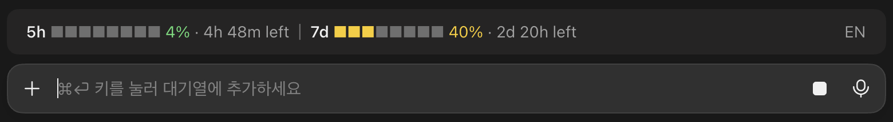
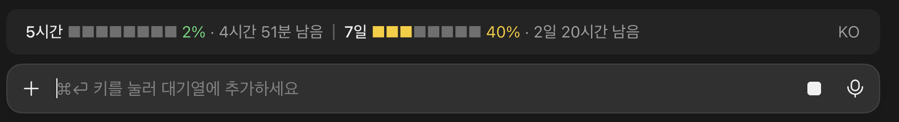

# limit-bar

A tiny mod for Claude Code that shows **only your 5-hour and 7-day usage limits** in one row above the prompt: how much you have used, and how long until each limit resets. Nothing else (no model name, context size or sub-agents).

```
5h ████░░░░ 52% · 4h 13m left  │  7d ██░░░░░░ 24% · 5d 6h left                    EN
```

## Screenshots

| English | 한국어 |
|---|---|
|  |  |

## Features

- **Gauge color follows usage.** The filled cells shift smoothly from green to yellow, orange and red as usage grows, so you can read it at a glance.
- **The empty part of the gauge is a faint background**, clearly separate from the filled part.
- **Always one line.** On a wide window you get the gauge; on a narrow one the gauge drops out and the text stays; on a very narrow one the end is cut with `…`.
- **Time left refreshes every minute**, and the numbers update as the engine reports new usage.
- **English or Korean.** A small `EN` / `KO` button at the right end of the row switches the language with one click, and your choice is remembered across sessions. By default the language follows your device (Korean on a Korean device, English otherwise); you can also pin it in the plugin settings.
- Only shown for subscription plans that report these limits. If no limit data is available yet, the row is not drawn.

## Install

At the prompt of a terminal session:

```
/plugin install limit-bar --marketplace UXmanual/limit-bar
```

From a shell:

```
claude plugin install limit-bar --marketplace UXmanual/limit-bar
```

In the desktop app, where `/plugin` does not run: click **+** next to the prompt box, then **Plugins**, **Add marketplace** with `UXmanual/limit-bar`, then **Add plugin**.

You will be asked to add the marketplace (answer `y`), to pick a scope, and to set the language option (`auto`, `en` or `ko`).

## Settings

| Option | Values | Default | What it does |
|---|---|---|---|
| `language` | `auto`, `en`, `ko` | `auto` | Display language of the bar. The `EN` / `KO` button overrides it and remembers the choice. |

## Notes

- The mod only reads the usage numbers the app already has. It sends nothing anywhere and stores only your language choice, on your own machine.
- Colors use plain hex values, so the gradient needs a terminal or app that shows true color.

## License

MIT, see [LICENSE](LICENSE).

## About the author

Made by [UXmanual](https://github.com/UXmanual). I also build Peaker, a hiking app for Korea: https://peaker.kr
